# Real-Time Messaging Application

[](#español)
[](#english)

---

<a name="english"></a>

## 🇬🇧 English

A real-time messaging application built with **Angular**, **Node.js**, and **Express**. The application uses **Socket.IO** for real-time communication and **MongoDB** for persistent data storage.

Users can communicate through private and group chats, send images, manage their profiles, and perform account-related actions through a real-time socket-based architecture.

## Features

- **Real-time messaging** using Socket.IO.
- **Private conversations** between users.
- **Group chats** with no application-defined participant limit.
- **Image sharing** using Cloudinary for image hosting.
- **Profile management**, including:
- Change username.
- Change profile picture.

- **Account deletion**.
- **Real-time chat requests** using sockets.
- **Add users to existing groups** through socket communication.
- Real-time communication between connected clients.

## Tech Stack

### Frontend

- **Angular**
- **Bootstrap**
- **Socket.IO Client**

### Backend

- **Node.js**
- **Express**
- **Socket.IO**

### Database & Storage

- **MongoDB** — Persistent application data.
- **Cloudinary** — Image hosting and storage.

## Screenshots

### Main View

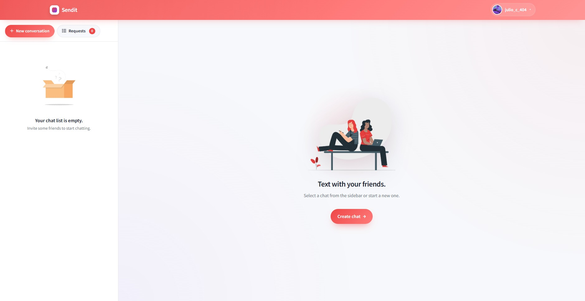

### Login View

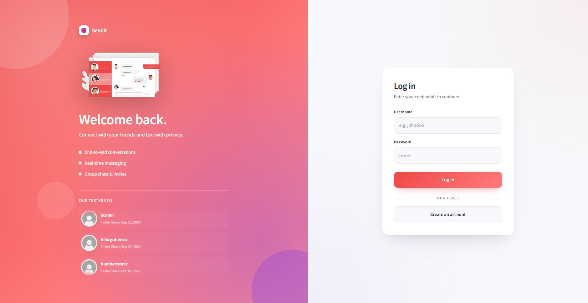

### Register View

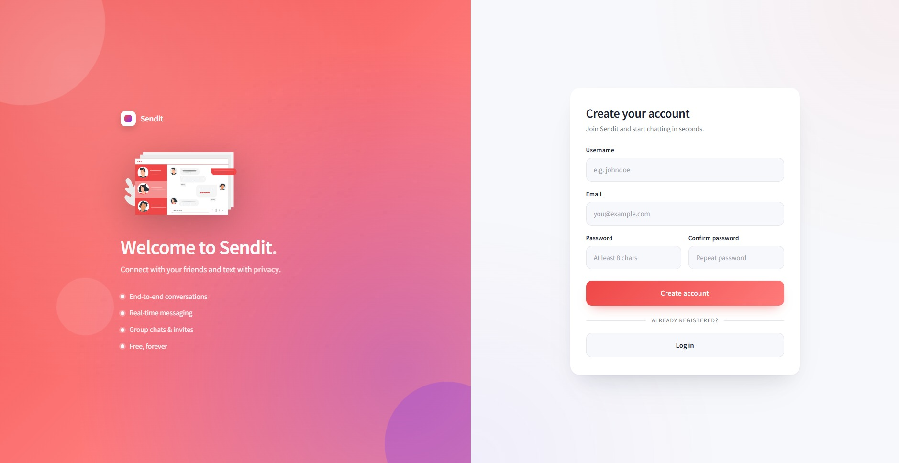

### Group Chat

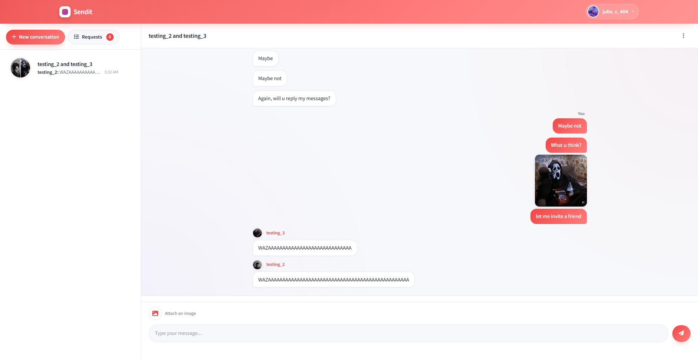

### Unread Messages

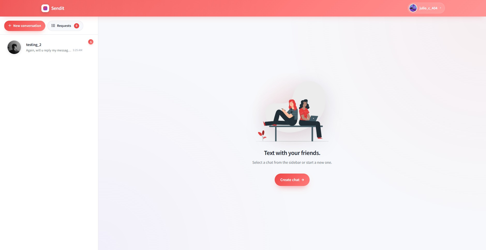

### Duo Chat


## Requests

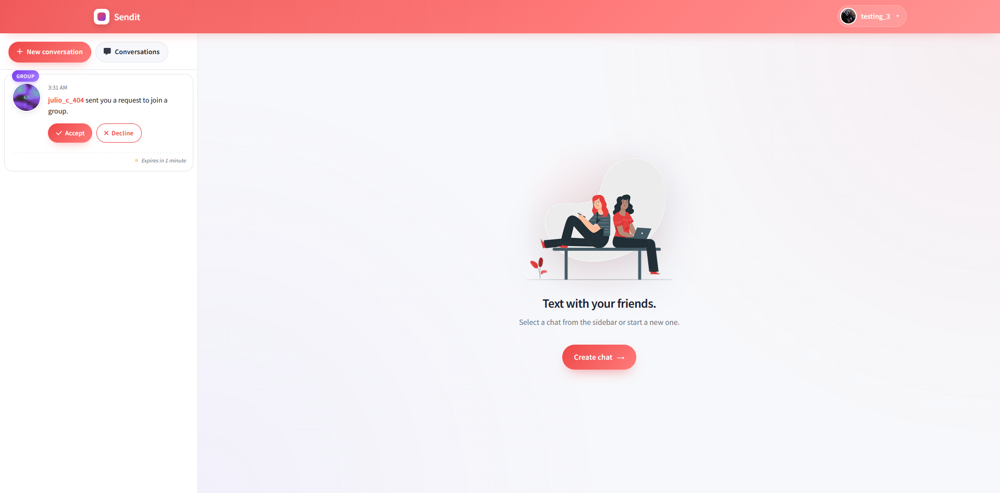
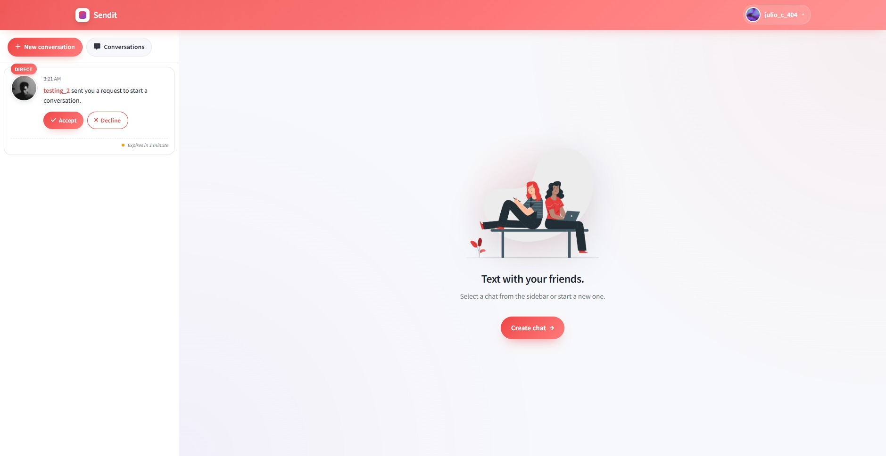

### Invite Friends or Create Chat

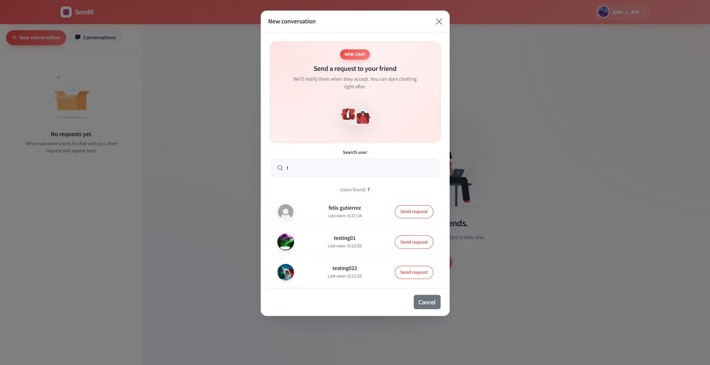
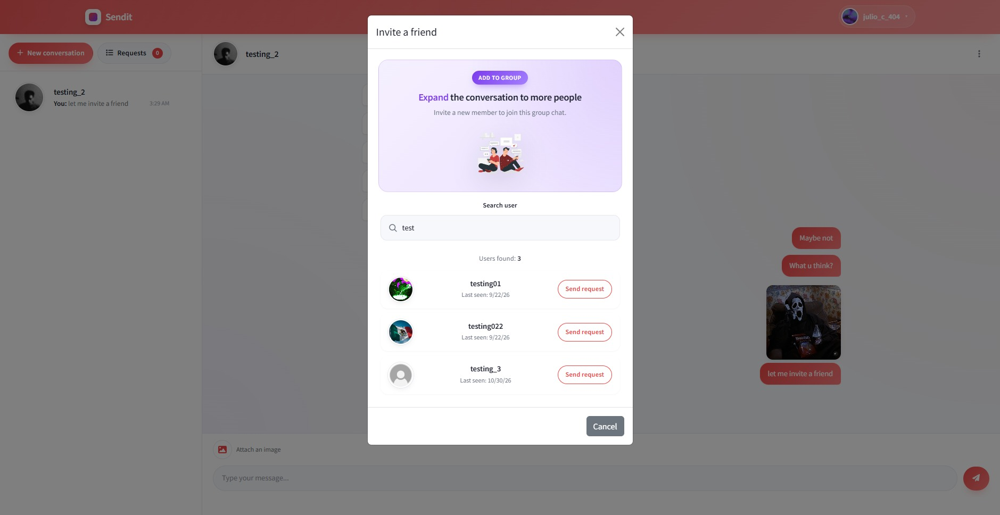

### Profile

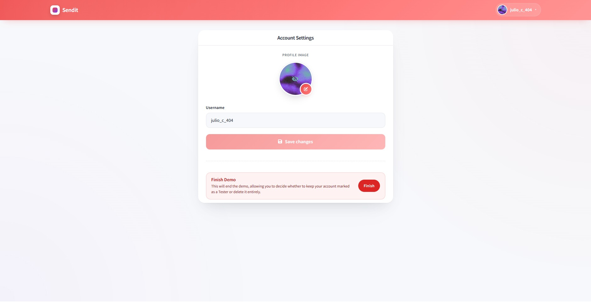

## Architecture

The application is divided into a frontend client and a backend server.

```text
                    ┌─────────────────────┐
                    │       Angular       │
                    │      Frontend       │
                    │                     │
                    │  Chat UI            │
                    │  Groups             │
                    │  Profiles           │
                    └──────────┬──────────┘
                               │
                               │ Socket.IO
                               │
                               ▼
                    ┌─────────────────────┐
                    │   Node.js / Express │
                    │      Backend        │
                    │                     │
                    │  Socket Management  │
                    │  Chat Logic         │
                    │  Group Logic        │
                    │  User Management    │
                    └──────┬────────┬─────┘
                           │        │
                    ┌──────▼───┐  ┌─▼───────────┐
                    │ MongoDB  │  │  Cloudinary │
                    │          │  │             │
                    │ Users    │  │   Images    │
                    │ Messages │  │   Storage   │
                    │ Groups   │  │             │
                    └──────────┘  └─────────────┘
```

## Real-Time Communication

The application relies heavily on **Socket.IO** for real-time communication.

Sockets are used not only for sending messages, but also for several chat-related operations, including:

- Sending and receiving messages.
- Starting conversations.
- Sending chat requests.
- Adding users to existing groups.
- Updating conversations in real time.

This allows connected clients to receive events without continuously polling the server through HTTP requests.

### Example message flow

```text
User A
   │
   │ Socket Event
   ▼
Node.js / Socket.IO
   │
   ├──────────────► MongoDB
   │
   │ Socket Event
   ▼
User B / Group
```

When a user sends a message:

1. The Angular client emits a socket event.
2. The Node.js server receives the event.
3. The message is processed and persisted in MongoDB.
4. The server emits the corresponding event to the recipient or group.
5. Connected clients receive the message in real time.

## Image Handling

Images are hosted using **Cloudinary** rather than being stored directly in MongoDB.

The general flow is:

```text
Angular
   │
   │ Image upload
   ▼
Cloudinary
   │
   │ Image URL
   ▼
Application
   │
   │ Message / Profile data
   ▼
MongoDB
```

Cloudinary handles the image storage, while the application stores the corresponding image reference.

## Group Chats

The application supports group conversations with **no predefined participant limit at the application level**.

Users can:

- Create group conversations.
- Add users to existing groups.
- Send messages to group members.
- Receive group messages in real time.

The practical scalability of a group will ultimately depend on the server, database, network, and infrastructure resources available.

## Profile Management

Users can manage their profile through the application.

Available actions include:

- Changing their username.
- Changing their profile picture.
- Deleting their account.

Profile images are handled through Cloudinary.

## Data Storage

**MongoDB** is used as the application's persistent database.

It is responsible for storing application data such as:

- Users.
- Messages.
- Conversations.
- Groups.
- Other persistent information required by the application.

Images themselves are hosted through Cloudinary.

## Getting Started

### Prerequisites

Make sure you have installed:

- Node.js
- pnpm (please)
- Angular CLI
- MongoDB
- A Cloudinary account

### Clone the repository

```bash
git clone <repository-url>

cd <project-directory>
```

### Install dependencies

Install the backend dependencies (USE PNPM):

```bash
pnpm install
```

Then install the Angular dependencies:

```bash
cd client
pnpm install
```

> Adjust the directory names according to the actual project structure.

## Environment Variables

The requires environment variables for services such as MongoDB and Cloudinary.

Example:

```env
PORT=3000
MONGODB_URI=mongodb://<db_password>/<your_cluster>
CLOUDINARY_CLOUD_NAME=your_cloud_name
CLOUDINARY_API_KEY=your_api_key
CLOUDINARY_API_SECRET=your_api_secret
```

Add your environment file to `.gitignore`:

```gitignore
.env
node_modules/
dist/
```

## Running the Application

### Backend

```bash
pnpm run dev
```

or:

```bash
pnpm start
```

### Frontend

From the Angular project directory:

```bash
ng serve
```

The frontend will normally be available at:

```text
http://localhost:4200
```

The backend will run on the port configured in your environment variables.

## Project Highlights

This project focuses on implementing a **real-time, event-driven messaging architecture** rather than relying exclusively on traditional HTTP requests.

Socket.IO is used for both messaging and several chat-management operations, while MongoDB provides persistent storage and Cloudinary handles image hosting.

The architecture allows multiple connected clients to communicate and receive application events in real time.

## License

<a name="español"></a>

## 🇪🇸 Español

# Aplicación de Mensajería en Tiempo Real

**Una aplicación de mensajería en tiempo real desarrollada con Angular, Node.js y Express.** Utiliza Socket.IO para la comunicación en tiempo real y MongoDB para el almacenamiento persistente de datos.

Los usuarios pueden comunicarse mediante conversaciones privadas y grupales, compartir imágenes, administrar sus perfiles y realizar acciones relacionadas con sus cuentas a través de una arquitectura basada en sockets.

## Características

- **Mensajería en tiempo real** mediante Socket.IO.
- **Conversaciones privadas** entre usuarios.
- **Chats grupales** sin un límite de participantes definido a nivel de aplicación.
- **Envío de imágenes** utilizando Cloudinary para su alojamiento.
- **Administración de perfiles**, incluyendo:
  - Cambiar nombre de usuario.
  - Cambiar foto de perfil.
- **Eliminación de cuentas.**
- **Solicitudes de chat en tiempo real** mediante sockets.
- **Agregar usuarios a grupos existentes** mediante comunicación por sockets.
- Comunicación en tiempo real entre clientes conectados.

## Tecnologías utilizadas

### Frontend

- **Angular**
- **Bootstrap**
- **Socket.IO Client**

### Backend

- **Node.js**
- **Express**
- **Socket.IO**

### Base de datos y almacenamiento

- **MongoDB** — Almacenamiento persistente de los datos de la aplicación.
- **Cloudinary** — Alojamiento y almacenamiento de imágenes.

## Capturas de pantalla

### Vista principal


### Inicio de sesión


### Registro


### Chat grupal


### Mensajes sin leer


### Chat privado

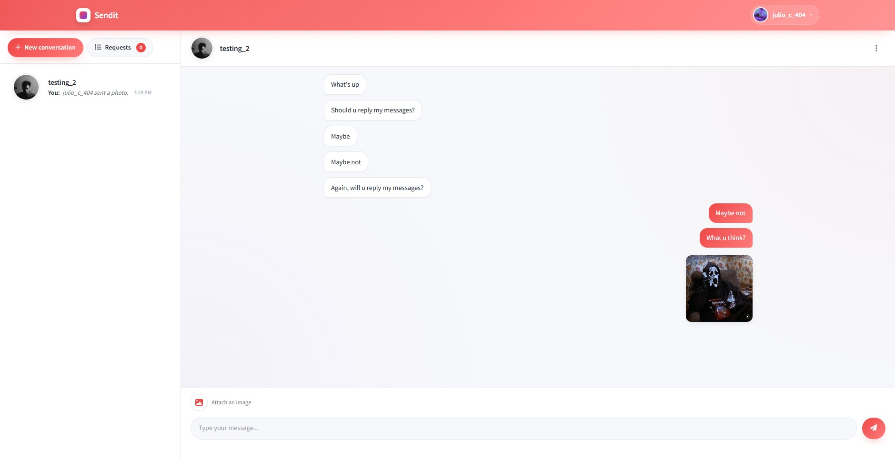

## Solicitudes


### Invitar amigos o crear un chat


### Perfil


## Arquitectura

La aplicación está dividida en dos componentes principales: un cliente frontend y un servidor backend.

```text
                   ┌─────────────────────┐
                   │       Angular       │
                   │      Frontend       │
                   │                     │
                   │  Interfaz de chat   │
                   │  Grupos             │
                   │  Perfiles           │
                   └──────────┬──────────┘
                              │
                              │ Socket.IO
                              │
                              ▼
                   ┌─────────────────────┐
                   │   Node.js / Express │
                   │      Backend        │
                   │                     │
                   │ Gestión de sockets  │
                   │ Lógica de chats     │
                   │ Lógica de grupos    │
                   │ Gestión de usuarios │
                   └──────┬────────┬─────┘
                          │        │
                   ┌──────▼───┐  ┌─▼───────────┐
                   │ MongoDB  │  │ Cloudinary  │
                   │          │  │             │
                   │ Usuarios │  │  Imágenes   │
                   │ Mensajes │  │ Almacenamiento
                   │ Grupos   │  │             │
                   └──────────┘  └─────────────┘
```

## Comunicación en tiempo real

La aplicación depende en gran medida de **Socket.IO** para gestionar la comunicación en tiempo real.

Los sockets no se utilizan únicamente para enviar mensajes, sino también para realizar distintas operaciones relacionadas con los chats, entre ellas:

- Enviar y recibir mensajes.
- Iniciar conversaciones.
- Enviar solicitudes de chat.
- Agregar usuarios a grupos existentes.
- Actualizar conversaciones en tiempo real.

Esto permite que los clientes conectados reciban eventos sin necesidad de consultar continuamente al servidor mediante solicitudes HTTP (polling).

### Ejemplo del flujo de un mensaje

```text
Usuario A
   │
   │ Evento Socket
   ▼
Node.js / Socket.IO
   │
   ├──────────────► MongoDB
   │
   │ Evento Socket
   ▼
Usuario B / Grupo
```

Cuando un usuario envía un mensaje:

1. El cliente Angular emite un evento mediante un socket.
2. El servidor Node.js recibe el evento.
3. El mensaje se procesa y se almacena en MongoDB.
4. El servidor emite el evento correspondiente al destinatario o grupo.
5. Los clientes conectados reciben el mensaje en tiempo real.

## Gestión de imágenes

Las imágenes se alojan mediante **Cloudinary**, en lugar de almacenarse directamente en MongoDB.

El flujo general es el siguiente:

```text
Angular
   │
   │ Carga de imagen
   ▼
Cloudinary
   │
   │ URL de imagen
   ▼
Aplicación
   │
   │ Datos del mensaje / Perfil
   ▼
MongoDB
```

Cloudinary se encarga del almacenamiento de las imágenes, mientras que la aplicación guarda la referencia correspondiente en la base de datos.

## Chats grupales

La aplicación permite crear conversaciones grupales **sin un límite predefinido de participantes a nivel de aplicación**.

Los usuarios pueden:

- Crear conversaciones grupales.
- Agregar usuarios a grupos existentes.
- Enviar mensajes a los integrantes de un grupo.
- Recibir mensajes grupales en tiempo real.

La escalabilidad práctica de los grupos dependerá de los recursos disponibles del servidor, la base de datos, la red y la infraestructura.

## Administración de perfiles

Los usuarios pueden administrar su perfil directamente desde la aplicación.

Las acciones disponibles incluyen:

- Cambiar su nombre de usuario.
- Cambiar su foto de perfil.
- Eliminar su cuenta.

Las imágenes de perfil se gestionan mediante Cloudinary.

## Almacenamiento de datos

**MongoDB** se utiliza como base de datos persistente de la aplicación.

Es responsable de almacenar información como:

- Usuarios.
- Mensajes.
- Conversaciones.
- Grupos.
- Otros datos persistentes necesarios para el funcionamiento de la aplicación.

Las imágenes se alojan externamente mediante Cloudinary.

## Instalación y configuración

### Requisitos previos

Asegúrate de tener instaladas las siguientes herramientas:

- Node.js
- pnpm (por favor).
- Angular CLI
- MongoDB
- Una cuenta de Cloudinary.

### Clonar el repositorio

```bash
git clone <repository-url>

cd <project-directory>
```

### Instalar dependencias

Instala las dependencias del backend (**UTILIZA PNPM**):

```bash
pnpm install
```

Después, instala las dependencias de Angular:

```bash
cd client
pnpm install
```

> Ajusta los nombres de los directorios según la estructura real del proyecto.

## Variables de entorno

La aplicación requiere variables de entorno para configurar servicios como MongoDB y Cloudinary.

Ejemplo:

```env
PORT=3000
MONGODB_URI=mongodb://<db_password>/<your_cluster>
CLOUDINARY_CLOUD_NAME=your_cloud_name
CLOUDINARY_API_KEY=your_api_key
CLOUDINARY_API_SECRET=your_api_secret
```

Agrega el archivo de variables de entorno a `.gitignore` para evitar subir información sensible al repositorio:

```gitignore
.env
node_modules/
dist/
```

## Ejecutar la aplicación

### Backend

```bash
pnpm run dev
```

O bien:

```bash
pnpm start
```

### Frontend

Desde el directorio del proyecto Angular:

```bash
ng serve
```

El frontend estará disponible normalmente en:

```text
http://localhost:4200
```

El backend se ejecutará en el puerto configurado mediante las variables de entorno.

## Aspectos destacados del proyecto

Este proyecto se enfoca en implementar una **arquitectura de mensajería en tiempo real basada en eventos**, en lugar de depender exclusivamente de las solicitudes HTTP tradicionales.

Socket.IO se utiliza tanto para la mensajería como para diversas operaciones de administración de chats, mientras que MongoDB proporciona el almacenamiento persistente y Cloudinary se encarga del alojamiento de imágenes.

Esta arquitectura permite que múltiples clientes conectados se comuniquen y reciban eventos de la aplicación en tiempo real.

## Licencia
